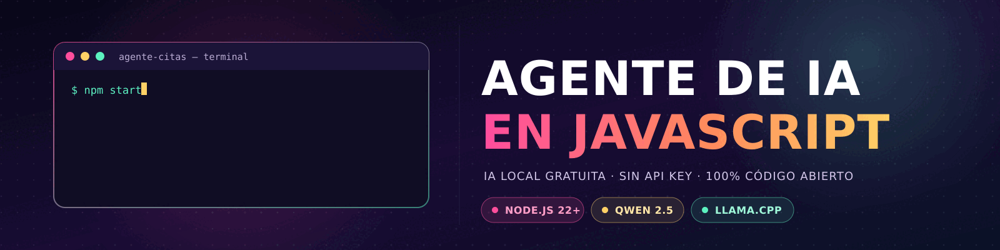

# Agente de citas con IA local gratuita

Agente en JavaScript para consultar, agendar y cancelar citas desde la terminal.
Funciona con **Qwen 2.5 1.5B y llama.cpp**, sin cuentas, claves ni pagos por uso.
Después de la instalación puede funcionar sin Internet. Usa CPU.

Basado en el [tutorial de Anand Sukumaran](https://dev.to/anandrmedia/how-to-build-an-ai-agent-in-javascript-from-scratch-5b6l).
Mantiene su ciclo: conversación → LLM → JSON → herramienta → resultado → LLM.
El paquete `openai` se usa como cliente del servidor local; no conecta a OpenAI
con la configuración incluida.

## Ejecutar

```bash
cd agente-citas-ia
npm install
npm start
```

En un equipo nuevo, ejecuta antes `npm run preparar` (descarga el motor y el
modelo; mira la sección siguiente). `npm start` inicia el motor instalado si está
apagado. Escribe `salir` para cerrar el chat. El motor permanece disponible; para
liberar su memoria:

```bash
npm run local:detener
```

## Instalar en otro equipo

Requisitos: Linux x86_64, Node.js 22+, Bash, curl y tar. Se recomienda 8 GB de RAM.

```bash
npm install
cp .env.example .env
npm run preparar
npm start
```

El instalador descarga llama.cpp (~22 MB comprimidos) y el modelo (~1,1 GB).
Instala en `~/.local/opt/llama.cpp` y `~/.local/share/llama.cpp/models`, sin sudo.
Las descargas incompletas del modelo se reanudan al ejecutar de nuevo `preparar`.

## Uso

Ejemplo: «Quiero una cita el 2 de diciembre de 2026 a las 10:00, hora de Bogotá».
El agente pide los datos que falten y puede ejecutar estas herramientas:

| Herramienta | Argumentos |
|---|---|
| `consultar_disponibilidad` | `fecha_hora` ISO 8601 con zona |
| `agendar_cita` | `fecha_hora`, `nombre`, `correo` |
| `cancelar_cita` | `fecha_hora`, `nombre`, `correo` |

Las citas duran 30 minutos, de lunes a viernes entre las 09:00 y las 18:00,
en la zona configurada. Se rechazan fechas pasadas y solapamientos. Las citas
persisten en `datos/citas.json`; la conversación solo dura la sesión.
El modelo pequeño puede equivocarse al interpretar fechas o solicitudes.

## Configuración

Edita `.env`; las variables del entorno tienen prioridad:

| Variable | Valor predeterminado |
|---|---|
| `MOTOR_LOCAL` | `llama` |
| `OPENAI_BASE_URL` | `http://127.0.0.1:8088/v1` |
| `OPENAI_MODEL` | `qwen2.5-local` (alias del modelo GGUF incluido) |
| `ZONA_HORARIA` | `America/Bogota` |
| `OPENAI_TEMPERATURE` | `0.2` |
| `JSON_MODE` | `1` |
| `ARCHIVO_CITAS` | `datos/citas.json` |

No necesitas definir `OPENAI_API_KEY` para el servidor local.

### Ollama como alternativa

El proyecto también conserva soporte para Ollama. Para usarlo, sustituye en `.env`:

```dotenv
MOTOR_LOCAL=ollama
OPENAI_BASE_URL=http://127.0.0.1:11434/v1
OPENAI_MODEL=qwen2.5:3b
```

Ejecuta `npm run preparar` y `npm start`. Esta opción descarga Ollama y su modelo
por separado; no reutiliza automáticamente el GGUF de llama.cpp.

## Comandos y diagnóstico

| Comando | Acción |
|---|---|
| `npm run preparar` | Instalar y arrancar el motor elegido |
| `npm start` | Abrir el agente |
| `npm run local:iniciar` | Arrancar el motor |
| `npm run local:estado` | Consultar los modelos disponibles |
| `npm run local:detener` | Detener el motor iniciado por el proyecto |
| `npm test` | Pruebas con cliente simulado, sin descargas |
| `npm run test:real` | 15 escenarios contra el modelo local real (escribe evidencias en `verificacion/resultados/`) |
| `npm run test:real` | 15 conversaciones con el modelo real y agendas temporales |

Si no arranca llama.cpp, revisa `~/.local/state/llama.cpp/servidor.log`.
Para Ollama, el registro está en `~/.local/state/ollama/ollama.log`.

### Verificar respuestas reales

```bash
npm run local:iniciar
npm run test:real
# Repetir únicamente algunos escenarios:
npm run test:real -- zona-horaria cancelar ocupado
```

Esta verificación llama al modelo configurado en `.env`, ejecuta las herramientas
reales y comprueba el contenido del archivo de citas después de cada turno.
Usa datos ficticios, una agenda temporal por escenario y un reloj de referencia
fijo: 24 de noviembre de 2026 a las 10:00 de Bogotá. El cliente LLM no se simula.

Las evidencias se guardan en `verificacion/resultados/` con fecha de ejecución:
preguntas, respuestas exactas, argumentos, resultados de herramientas, cambios
en la agenda y tiempos. Un control automático correcto de la agenda **no**
garantiza que la explicación del modelo sea correcta: también debe revisarse
el texto de la conversación. Las respuestas pueden variar entre ejecuciones.

## Código

- `index.js`: configuración, comprobación del servidor y terminal.
- `src/agente.js`: historial, protocolo JSON, límite de ocho pasos por turno y guardia contra llamadas repetidas a una misma herramienta.
- `src/citas.js`: validación, disponibilidad y persistencia.
- `src/herramientas.js`: funciones disponibles para el modelo.
- `src/prompt.js`: instrucciones del agente.
- `src/tiempo.js`: zonas horarias con Intl.
- `scripts/local.js`: selección del motor; scripts Bash para instalar y arrancar.
- `test/`: pruebas de agenda y del ciclo del agente con cliente simulado.
- `verificacion/real.js`: conversaciones contra el modelo real, con reloj y agenda aislados.
- `assets/banner.gif`: banner animado (escritura en la terminal, cursor y halo pulsante).
- `assets/banner.svg` y `assets/banner.png`: fuente editable y versión estática (1600×400).
